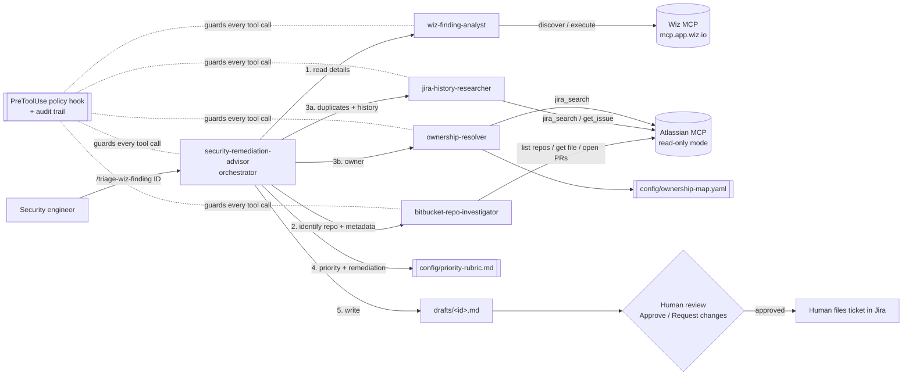

# XENA Security Remediation Advisor (XENA-PoC-01)

A **Workflow + Research agent** for VS Code Copilot Chat that triages a **critical Wiz finding** and gathers everything needed to start remediation. It uses two MCP servers, **Wiz** and **Atlassian (Jira and Bitbucket)**, and finishes with a **human-reviewed Jira ticket draft**.

> Team: EIC Group 2 · Stage: PoC · Scope: CRITICAL findings, XENA business unit, Jira project `JIFA` (XENA Developer Experience Support), Bitbucket project `ASX-XENA`

## What it does

The seven manual triage steps become one agent run plus one human review:

| # | Manual step today | Who does it in the PoC |
|---|---|---|
| 1 | Review the Wiz finding | `wiz-finding-analyst` (Wiz MCP) |
| 2 | Identify the repository | `bitbucket-repo-investigator` (Atlassian MCP → Bitbucket). It confirms the Wiz Code mapping or finds the repo from the image, app tag, or resource name. It then collects the default branch, the manifest line declaring the vulnerable version, CODEOWNERS, open fix PRs, and recent activity |
| 3 | Find the owning team | `ownership-resolver` (ownership map, CODEOWNERS from step 2, Jira history) |
| 4 | Search Jira for existing work | `jira-history-researcher` (duplicate detection) |
| 5 | Check history of similar fixes | `jira-history-researcher` (similar resolved issues) |
| 6 | Set priority | Orchestrator, using the [priority rubric](config/priority-rubric.md) |
| 7 | Create the ticket | Orchestrator **drafts** it in `drafts/`, and a **human** reviews and files it |



## Guardrails (risk mitigations from the use-case slide)

Write access is blocked by **three independent layers**, so a mistake in any one layer can't lead to a write:

| Layer | Mechanism | Where |
|---|---|---|
| 1. Server-side | `X-Atlassian-Read-Only-Mode: true` disables all Jira, Confluence, and Bitbucket write tools on the server | [.vscode/mcp.json](.vscode/mcp.json) |
| 2. Tool allowlist | Each agent gets only the tools it needs. No agent is given Jira create or update tools | [.github/agents/](.github/agents/) |
| 3. Policy hook | A `PreToolUse` hook on every advisor agent: **denies** Atlassian writes, Wiz write operations, shell commands, and file writes outside `drafts/`. It **denies** JQL that isn't scoped to `project = JIFA`, and **asks** before unknown Wiz operations, cross-project Jira reads, listing every Bitbucket repository, or reading repos outside `ASX-XENA` | [scripts/hooks/](scripts/hooks/) |

Additional controls:

- **Human in the loop**: The agent never files tickets. Drafts carry `DRAFT - PENDING HUMAN REVIEW` until a reviewer clicks **Approve draft**, and even then a human files the ticket.
- **Audit trail**: Every prompt, tool call, policy decision, and session event is appended to `audit/audit-log.jsonl`, with secret-like fields redacted.
- **Sensitive data**: `drafts/` and `audit/` are git-ignored. Credentials are prompted by VS Code and kept in its secret storage.
- **Prompt injection**: The agents treat Wiz, Jira, and Bitbucket content as untrusted data.
- **Wiz least privilege**: Wiz uses OAuth as the signed-in user. For the pilot, use an account or role with **read-only** Wiz permissions scoped to the XENA projects.

## Repository layout

```text
.github/agents/
  security-remediation-advisor.agent.md   # Orchestrator (user-facing)
  wiz-finding-analyst.agent.md            # Subagent: Wiz MCP (read-only)
  bitbucket-repo-investigator.agent.md    # Subagent: repo identification + metadata (Bitbucket)
  jira-history-researcher.agent.md        # Subagent: Jira duplicates + history
  ownership-resolver.agent.md             # Subagent: owner + confidence
.github/prompts/                          # /triage-wiz-finding, /triage-demo-offline, /list-critical-findings
.vscode/mcp.json                          # advisor-atlassian (read-only) + advisor-wiz
config/                                   # scope, ownership map, priority rubric
templates/jira-ticket-draft.md            # Draft format the agent fills in
scripts/hooks/                            # Policy + audit hook (Node, no dependencies)
scripts/live/mcp-client.cjs               # Minimal MCP Streamable HTTP client + Wiz OAuth (PKCE, read:all only)
scripts/live/live-smoke.cjs               # Policy-gated live smoke test against the real MCP servers
demo/                                     # Offline fixtures (3 scenarios) + guardrail demo
eval/                                     # Scorecard for success metrics
tests/                                    # node:test unit tests for policy, scoring, and the live smoke dry run
drafts/  audit/                           # Runtime output (git-ignored)
```

## Setup

### Prerequisites

- VS Code 1.10x or later with GitHub Copilot Chat, with Agent mode enabled.
- Node.js 18 or later, used by the hook scripts. The scripts have no npm dependencies.
- Access to Wiz (with the MCP integration enabled for your tenant), a Jira personal access token with read access to `JIFA`, and a Bitbucket personal access token with repository read access to `ASX-XENA`.

### Steps

1. Open **this folder** as the workspace root, then trust the workspace. Hooks run only in trusted workspaces, and their command paths are relative to the root.
2. Run the tests to confirm the guardrails work:

   ```bash
   npm test
   npm run demo:guardrails
   ```

3. Open [.vscode/mcp.json](.vscode/mcp.json) and click **Start** on `advisor-atlassian` and `advisor-wiz`.
   - `advisor-atlassian` connects to `https://jira.jnj.com` and `https://sourcecode.jnj.com` and prompts for your Jira and Bitbucket PATs.
   - `advisor-wiz` prompts for your Wiz data center, then opens the browser for Wiz OAuth sign-in.
   - These are separate from any personal `mcp-atlassian-prod` or `wiz` servers you already have. They exist so read-only mode is guaranteed for the advisor.
4. In Copilot Chat, choose the agent **security-remediation-advisor** from the agent picker.
5. Replace the sample teams in [ownership-map.yaml](config/ownership-map.yaml) with real XENA repositories and teams.

> The hooks target the **Local** agent harness in VS Code, which supports agent-scoped hooks (Preview). If you run the agents in another harness, such as Copilot CLI or a Claude session, layers 1 and 2 still apply, but check that harness's hook support before you rely on layer 3.

## Live smoke test (real MCP servers)

`npm run live:smoke` replays the advisor's triage workflow against the real `advisor-atlassian` server (read-only mode, Xray off). Every tool call first goes through the same `evaluatePreToolUse` policy as the VS Code hook. Calls the policy denies or asks about are recorded as **blocked locally** and never reach the server.

```bash
npm run live:smoke -- --dry-run                 # no network: print every step's policy decision
npm run live:smoke                              # Atlassian leg (tools/list, negative checks, Jira + Bitbucket reads)
npm run live:smoke -- --repo xena-cli --search log4j
npm run live:smoke:wiz                          # also the Wiz leg (browser sign-in)
```

- **Atlassian**: tokens come from the git-ignored `.env` (`JIRA_PAT`, `BITBUCKET_PAT`, see `.env.example`); environment variables override them. Tokens are never printed or logged. The run checks that every `advisor-atlassian/*` tool used by the agents exists, reports write-like tools the server still exposes, proves writes and unscoped or cross-project JQL are blocked, then reads Jira (`project = JIFA`, issue keys `JIFA-<n>`) and one `ASX-XENA` repository (default: the first one listed): default branch, files, open PRs, commits, manifest, and CODEOWNERS.
- **Wiz** (`--wiz`): opens the browser for OAuth sign-in (PKCE, dynamic client registration) and requests **only** the `read:all` scope. The token stays in memory. It lists the tools, calls `discover`, and proves a write such as `update_issue_status` is denied. `--wiz-exec <tool> --wiz-args '<json>'` adds one `execute` call, sent only if the policy passes it.
- **Audit**: every step, sent or blocked, is appended to `audit/live-smoke.jsonl` in the same record shape as the hook. The command exits with code 1 if a read fails or a negative check isn't blocked.

## Demo script (about 10 minutes)

| Time | Show | How |
|---|---|---|
| 0:00 | The problem | Seven manual steps per critical finding (use-case slide) |
| 1:00 | Guardrails first | `npm run demo:guardrails` shows Jira creates, Bitbucket branch creation, Wiz writes, unscoped JQL, and shell commands blocked; out-of-project repo reads prompting for confirmation; and reads allowed |
| 3:00 | Scenario A: new critical | `/triage-demo-offline wiz-demo-0001` shows a Log4Shell finding on prod **with no Wiz repo mapping**. Bitbucket matches the image `xena/xena-api` to `ASX-XENA/xena-api` and confirms `log4j2.version` 2.14.1 at `pom.xml:42`. It ranks the decoy `xena-api-gateway` lower. Expect **P1**, owner **Core Services**, precedent XENA-987, and **CREATE NEW** |
| 5:00 | Scenario B: duplicate | `/triage-demo-offline wiz-demo-0002` shows regreSSHion. Expect **UPDATE EXISTING XENA-1311**, plus open fix PR #61 found in Bitbucket and a suggested comment |
| 6:30 | Scenario C: scope | `/triage-demo-offline wiz-demo-0003` shows a HIGH finding. Expect it to be stopped as out of PoC scope |
| 7:30 | Human in the loop | Click **Request changes** (for example, change the owner), then **Approve draft**. Show the Review section in `drafts/` |
| 8:30 | Live data (optional) | `/list-critical-findings`, then `/triage-wiz-finding <real id>` against the live MCP servers |
| 9:30 | Audit and metrics | `npm run audit:tail`, then fill in [scorecard.csv](eval/scorecard.csv) and run `npm run score` |

If the live MCP servers aren't available during the demo, the offline scenarios are the **manual fallback** from the risk plan.

## Measuring success

Record every triaged finding in [scorecard.csv](eval/scorecard.csv): the expected values from the reviewer, the agent's values, whether the draft was accepted without rework, and the minutes spent triaging manually versus with the agent. Then run:

```bash
npm run score
```

The script reports **repository accuracy**, **owner accuracy**, **priority accuracy**, **duplicate accuracy**, **percentage of drafts accepted without rework**, and **triage time per finding (baseline → agent)**, which are the success metrics on the use-case slide.

## Customizing

| Change | Edit |
|---|---|
| Jira project or severity scope | [advisor.config.json](config/advisor.config.json). The hook enforces `jiraProject` automatically. `jiraProjectKey` is optional: set it only when the issue-key prefix differs from the project name used in JQL (JIFA's name and key are the same, so it's omitted) |
| Bitbucket project(s) | `bitbucketProjects` in [advisor.config.json](config/advisor.config.json). Repos in other projects require confirmation |
| Priority logic or SLAs | [priority-rubric.md](config/priority-rubric.md) |
| Ticket format or required fields | [jira-ticket-draft.md](templates/jira-ticket-draft.md) |
| Allowed read-only Atlassian tools | `ATLASSIAN_READ_OPS` in [policy.cjs](scripts/hooks/lib/policy.cjs) |
| Wiz read and write classification | `WIZ_READ_PREFIX` and `WIZ_WRITE_VERB` in [policy.cjs](scripts/hooks/lib/policy.cjs) |

To find the exact tool names the Local harness reports, read the `tool` field in `audit/audit-log.jsonl` after a run.

## Known limitations (PoC)

- **Wiz runs every tool through `execute`.** The Wiz MCP server exposes only `discover` and `execute`, so the hook classifies each `execute` call by its inner `tool_name` (read prefix, write verb, or ask). The live tool names were verified on 2026-10-20 and are listed in [wiz-finding-analyst.agent.md](.github/agents/wiz-finding-analyst.agent.md). Known write tools (`resolve_issue`, `update_issue`, `create_service_ticket`) are denied, and `vulnerability_finding_triage_skill` asks first.
- **Wiz visibility depends on the signed-in user.** With the pilot account, `list_issues` returned no CRITICAL issues and `list_vulnerability_findings` returned nothing at all. The account needs read access to the XENA Wiz projects, including vulnerability findings, before live triage can find in-scope findings.
- **JQL scoping is parsed, not executed.** The hook requires `project = JIFA` (or `project in (JIFA)`; also the `jiraProjectKey` value, if set) as a top-level `AND` condition and denies any top-level `OR` or `||`, so other conditions can only narrow the results. It ignores quoted text and anything in parentheses, denies unbalanced JQL, and restricts the `projects_filter` argument to the same project. Server-side `JIRA_PROJECTS_FILTER` would be stronger, but it isn't available through header authentication.
- **No Bitbucket code search.** The Atlassian MCP server has no code-search tool, so the repository is matched by name against the `ASX-XENA` repo list. Then the investigator reads the expected manifest files to confirm the package. Repos whose names don't resemble the image, app, or resource name come back as `Low` confidence for the reviewer.
- **Ownership quality depends on the map.** Low-confidence owners are flagged for the reviewer.
- **One finding per run.** Batch triage and auto-escalation are out of scope for this PoC.

## Next steps after the PoC

1. Pilot with the named security owner on 20 to 30 real critical findings, and record the results in the scorecard.
2. Write an SOP for reviewing drafts, and add a feedback loop that turns reviewer corrections into ownership-map updates.
3. Once draft acceptance stays above the agreed threshold, consider gated ticket creation, where a human clicks **File** and the agent creates the ticket. That would be a separate, explicitly approved scope change.
